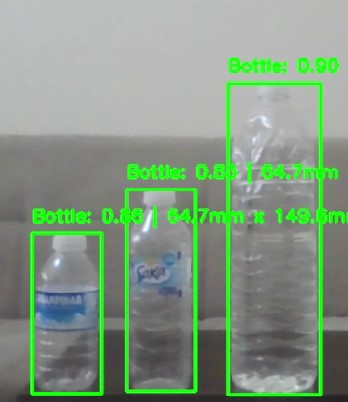

# BottleDetector 🍼
- This project implements a real-time bottle detection and measurement system using YOLOv8. 
- It detects bottles from a live camera feed and measures their width and height in millimeters within a specified rectangular area. 

🚀 Features

- Real-time detection of bottles using YOLOv8.
- Measures the dimensions of detected bottles in a defined region.
- Converts pixels to millimeters for accurate size estimation.
- Highlights detected bottles and displays confidence scores.
- Shows the defined rectangular measurement area on the video feed.
- Works with a standard webcam.

📂 Project Structure
BottleDetector/
│── bottle_detector.py      # Main detection and measurement script
│── README.md               # Project description
│── requirements.txt        # Dependencies
│── results/                # (Optional) save snapshots or outputs
 

🔧 Installation
- Clone the repository and install dependencies:
- git clone https://github.com/Rasittekin18/BottleDetector.git
- cd BottleDetector
- pip install -r requirements.txt
 

▶️ Usage
- Run the detection script:
- python bottle_detector.py

- Press q to quit the video window.
- Detected bottles inside the defined rectangle will be highlighted in green.
- Rectangle boundary for measurement is drawn in red.
- Text overlay shows confidence score and width x height in mm.

